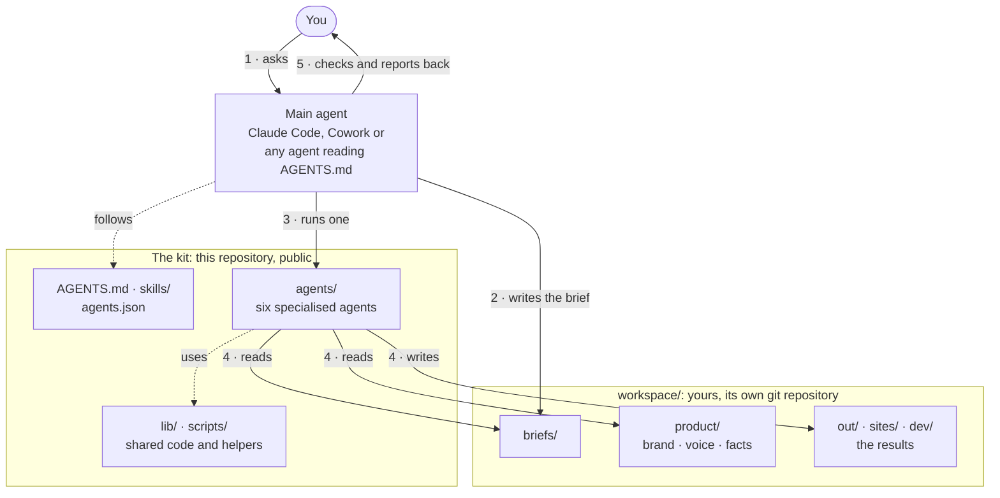

# superproduct

**One product folder, six AI agents.** superproduct is an open-source set of
[Claude Agent SDK](https://github.com/anthropics/claude-agent-sdk-typescript) agents that make marketing and product
work for *your* product: LinkedIn carousels, editorial collage posts, decks and reports, explainer videos, landing
pages, and features on your GitHub repositories. Every agent reads the same **product folder** (brand tokens, logo,
fonts, voice, verified facts, offers, go-to-market and development notes), so what they make is on-brand and
on-message. Swap the folder and the same agents work for another brand.

You don't drive the agents one by one. You talk to one Claude ([Claude Code](https://github.com/anthropics/claude-code),
or Cowork in the Claude desktop app) opened in this folder. Following [`AGENTS.md`](AGENTS.md), it routes each request
to the right agent, writes the brief, runs it with a budget, relays the agent's questions, checks the result and reports
back. [How it works](#how-it-works) shows the whole loop.

## The agents

| Agent | Makes | Needs |
|---|---|---|
| [**carousel**](agents/carousel-agent) | LinkedIn document carousels and single graphic posts in six styles (consulting, bold poster, minimal, editorial, tech launch, paper showcase): PDF, PNGs, caption | Claude; OpenAI for imagery (optional) |
| [**collage-post**](agents/collage-post-agent) | Editorial collage posts and carousels, 1080×1350 (cutouts, duotones, torn paper, loud type): PNGs, caption | Claude, OpenAI |
| [**deck**](agents/deck-agent) | 16:9 decks and A4 reports from a brief and your data, with charts, tables and diagrams: searchable PDF | Claude; OpenAI for images (optional) |
| [**explainer**](agents/explainer-agent) | Explainer and motion-graphics videos that teach a newcomer (TED-Ed-style), 4:5 by default (9:16, 1:1, 16:9), made with [HyperFrames](https://github.com/heygen-com/hyperframes) and all its skills: a storyboard to approve first, then the video in a cinematic editorial style (B&W cut-outs on brand colour, camera moves, callouts) or a Vox-style paper collage; pictures generated in the product's illustration style; narration, music and sound effects: MP4, contact sheet, caption | Claude, FFmpeg; OpenAI for pictures, ElevenLabs for narration, music and effects (both optional; HeyGen or a free local voice also narrate) |
| [**landing-page**](agents/landing-page-agent) | Next.js + Tailwind landing pages, linted, built, click-tested and screenshotted: static site | Claude |
| [**dev**](agents/dev-agent) | Features on an existing GitHub repository: PRD, milestone plan, tested commits in Docker, review, branch and draft PR | Claude, GitHub token, Docker |

They run on your computer and spend your own Claude credit (an API key or your Claude subscription); every run has a
budget cap. Each agent is self-contained, with its own README, `.env.example` and zero-cost tests.

## How it works

The project has three parts:

- **The main agent.** You talk to one coding agent opened in this folder: Claude Code, Cowork in the Claude desktop
  app, or another agent that reads [`AGENTS.md`](AGENTS.md) (`CLAUDE.md` imports it). It is the producer: it picks the
  agent, writes the brief, runs it with a budget, relays its questions, checks the result and reports back. It doesn't
  make the carousel or the deck itself.
- **The kit**, this repository, all public: the six agents in `agents/` (each a self-contained Claude Agent SDK app
  with its own CLI, design system and tests), one skill per agent in `skills/` (how to brief and run it), the registry
  `agents.json`, and the shared code in `lib/` and `scripts/` that finds the product, knows where files go, and
  checks, installs and tests the agents. Nothing of yours is in it.
- **The workspace**, `workspace/`: your product folder (brand, voice, facts, offers), your briefs and everything the
  agents make. The kit's `.gitignore` leaves it out, and it is a git repository of its own.



A request, step by step:

1. **You ask:** "A LinkedIn carousel about our spring offer, portrait, 5 slides."
2. **The main agent writes the brief.** It picks the carousel agent, checks that it's ready
   (`node scripts/agents.mjs status`) and writes `workspace/briefs/2026-10-11-spring-offer.md` with only what is
   specific to this job: the product's brand, voice and facts are already in the product folder.
3. **It runs the agent** from the agent's folder, with a spend cap:
   `cd agents/carousel-agent && npm run generate -- --file ../../workspace/briefs/2026-10-11-spring-offer.md --budget 3`.
4. **The agent does the work.** It loads the product folder (the design tokens become its colours, fonts and logo; the
   voice and the verified facts go into its prompt), runs its own Claude session with its own tools to write, render
   and check the slides, and saves the result in `workspace/out/carousel/<run>/`.
5. **The main agent checks and reports.** It looks at the slides and the caption, then gives you the paths, the spend
   and any placeholders to fill. Changes go back through the agent (`--revise <job>`, or a re-run).

### The workspace

Everything that is yours lives in `workspace/`:

```
workspace/
├─ product/            the product the agents work for (below)
├─ products/           other products or clients (--product <id>)
├─ briefs/             what was asked, per job and per campaign
├─ out/<agent>/        carousels, collage posts, decks, videos
├─ sites/              landing pages
├─ dev/                dev-agent's repository setups and runs
└─ references/         your reference images
```

Pushing the kit can't publish your work, pulling a new version of the kit can't touch it, and the workspace can have a
private remote of its own ([`templates/workspace/README.md`](templates/workspace/README.md)). Keys stay in each agent's
`.env`. `SUPERPRODUCT_WORKSPACE` points the kit at another workspace, for example one per client.

### The product folder

`workspace/product/` is the single source of truth. The agents never hard-code a brand: they load the folder at run
time through [`lib/product.mjs`](lib/product.mjs), a zero-dependency loader.

```
workspace/product/
├─ BRIEF.md          one page every agent reads first
├─ product.json      identity, links, main action, offers, brand files, repositories, per-agent settings
├─ brand/            design.tokens.json (W3C DTCG, semantic colour roles), tokens.css, guidelines, voice, messaging
├─ offerings/        one file per offer
├─ knowledge/        facts register with sources, FAQ, glossary, open questions, captured sources
├─ strategy/ gtm/    positioning, audiences, competitors, channels, launches
├─ development/      architecture, roadmap, specs, research, metrics
├─ decisions/        decision records
└─ assets/           logos, fonts (open licences only), images with rights notes
```

- **Trust levels.** Every document is `verified`, `draft` or `template`. Agents state only verified facts, treat drafts
  as direction, and turn unknowns into visible placeholders such as `[X]` instead of inventing numbers.
- **Precedence.** Command-line flags (`--product`, `--brand`, `--palette`, …), then the product folder, then each
  agent's `.env`, then built-in defaults. `--product none` runs an agent without it.
- **Several products.** Keep one folder per product or client (`workspace/products/<id>/`) and pass `--product <id>`,
  switch `product/` over with `init --archive`, or give each client a workspace of its own.

The full spec, with the reasons behind the layout, is [`templates/product/README.md`](templates/product/README.md). A
complete fictional example is in [`lib/fixtures/acme`](lib/fixtures/acme).

## Quick start

You need Node 20.12+, git and Claude Code (or the Claude desktop app with Cowork); Docker for the dev agent; Node 22+
and FFmpeg for the explainer agent.

```bash
git clone https://github.com/no-boolshit-AI/superproduct.git
cd superproduct
```

**The easy way:** open the folder in Claude Code (or Cowork) and say *"Set me up."* Claude checks your computer, offers
to install what's missing, and walks you through each key: it opens the page where the key is made and a small window
to paste it into. You never edit a settings file.

**By hand:**

```bash
node scripts/agents.mjs setup           # checks this computer and the agents, lists what's missing and how to fix it
node scripts/agents.mjs install all     # npm install, Chromium and setup steps for every agent
node scripts/agents.mjs keys            # which keys each agent needs, what they cost, where to get them
node scripts/agents.mjs keys set OPENAI_API_KEY   # shows how to get it, asks for it, saves it for every agent that uses it
node scripts/agents.mjs test all        # zero-cost self-tests against a mock Claude API
node scripts/agents.mjs status          # installed? keys set (names only)? Chromium? Docker? FFmpeg?
```

Or let the [dashboard](#the-dashboard) walk you through it: `node scripts/dashboard.mjs --open`.

### Set up your product

```bash
node scripts/product.mjs init --name "Acme" --website https://acme.example
```

This creates `workspace/product/` from the template. Open Claude in this folder and ask it to fill the folder in:

> Set up the product folder from acme.example, our pitch deck and our LinkedIn page.

Claude captures the sources, measures the brand from your site into design tokens, writes the brief, facts, offers and
voice, marks inferences as drafts and lists open questions (skill [`product`](skills/product/SKILL.md)). Then:

```bash
node scripts/product.mjs check          # files, tokens, contrast, frontmatter, review dates
node scripts/product.mjs show           # what the agents will use
node scripts/product.mjs context deck   # exactly what one agent receives
```

To try the agents before your own product is ready, point them at the fictional fixture:
`export PRODUCT_DIR="$PWD/lib/fixtures/acme"` (from the repository root).

### Ask for work

> Make a LinkedIn carousel about our spring offer, portrait, 5 slides.
>
> Build a landing page for the new plan and a collage post announcing it.
>
> A board deck on Q3 from these two spreadsheets.
>
> A 45-second explainer video on what our product does, for the LinkedIn feed.
>
> Add CSV export to the invoices page in acme/shop.
>
> We changed our prices: \<link\>. Update the product folder.

Every agent also runs by hand from its folder; its README lists the commands, for example
`cd agents/deck-agent && npm run deck -- --file ../../workspace/briefs/2026-10-07-board.md`.

## The dashboard

```bash
node scripts/dashboard.mjs --open       # http://127.0.0.1:4646 (npm run dashboard)
```

A page in your browser for everything the agents do, read live from the workspace:

- **Home**: what's ready, what's being worked on, and which agent has a question (a storyboard to approve, the dev
  agent's questions and plans, which you can answer right there); your product's key documents and your connections.
- **Work**: every run with its status, spend and thumbnail. Open one to watch the video, page through the PDF, browse
  the slides, try the landing page at desktop and phone width, read the caption, and copy a revision request for Claude.
- **Files**: every file the agents made, by type, in a viewer.
- **Agents** and **Knowledge**: each agent's readiness, keys and settings; the product folder, verified and draft.
- **Setup**: a first-run walk-through. Paste keys once and choose which agents get them (they go into each agent's
  `.env` and are never shown again), install agents, run the free self-tests, and change budgets and models.

It has no dependencies, listens on this computer only (127.0.0.1), and refuses changes that don't come from the page
itself. It doesn't run agents: you ask Claude for work, and it shows up here.

## Keys

The dashboard's setup screen writes these for you; by hand:

| Agent | Claude | Other |
|---|---|---|
| carousel, deck, landing-page | the Claude Code login on your computer, or `ANTHROPIC_API_KEY` | `OPENAI_API_KEY` for images (carousel, deck; optional) |
| collage-post | `ANTHROPIC_API_KEY` | `OPENAI_API_KEY` |
| dev | `ANTHROPIC_API_KEY` or `CLAUDE_CODE_OAUTH_TOKEN` (from `claude setup-token`) | `GITHUB_TOKEN`, Docker |
| explainer | the Claude Code login on your computer, or `ANTHROPIC_API_KEY` | `OPENAI_API_KEY` for pictures; `ELEVENLABS_API_KEY` for narration, music and sound effects, or `HEYGEN_API_KEY` for narration (all optional) |

Keys go in each agent's own `.env`, which is git-ignored. You don't have to edit those files:
`node scripts/agents.mjs keys set <NAME>` shows how to get the key, asks for it without showing it, and saves it for every
agent that uses it. On a Mac, `keys ask <NAME>` also opens the page where the key is made. `keys` lists every
key, what it costs and where it's set; like `status`, it reports names, never values. A Claude API key is billed per use:
`keys set` leaves the agents that use your Claude Code login on your subscription unless you name them.

## Running in Cowork

Cowork's shell is a Linux VM that sees this folder but not your computer's Chromium, Docker or `node_modules`, so the
agents always run on your computer. In Cowork, Claude writes the briefs, gives you the command to paste into a
terminal, and follows the run through its output files. `status`, `outputs`, the dev-agent relay (`pending`, `answer`),
`scripts/product.mjs` and `scripts/workspace.mjs` work from the VM.

## Repository layout

```
├─ CLAUDE.md             instructions for the main Claude: routing, briefs, budgets, review, rules
├─ agents.json           registry: commands, install and test steps, required keys, outputs
├─ agents/               the six agents
├─ skills/               one skill per agent, plus product, campaign (multi-agent work) and setup (installs, keys)
├─ lib/product.mjs       product folder loader: find, validate, tokens to colours and fonts, compiled context
├─ lib/workspace.mjs     where the workspace is and what goes where (+ workspace-migrate.mjs from the old layout)
├─ lib/agents.mjs        registry, readiness, results and the dev-agent relay (shared by the CLI and the dashboard)
├─ lib/env-file.mjs      an agent's settings from its .env.example; changes to its .env
├─ dashboard/            the dashboard: its server (server.mjs, runs.mjs) and the page (public/)
├─ lib/fixtures/acme/    fictional example product, used by the tests
├─ schemas/              JSON Schema for product.json
├─ scripts/agents.mjs    setup · init · list · status · outputs · install · keys · test · run · web · pending · answer
├─ scripts/product.mjs   init · show · check · context · tokens · index · fetch
├─ scripts/workspace.mjs show · init · migrate
├─ scripts/dashboard.mjs the dashboard on http://127.0.0.1:4646
├─ templates/product/    blank product folder and its spec
├─ templates/workspace/  what a new workspace starts with (README, .gitignore, briefs/)
└─ workspace/            your product, briefs and results (created by init; git-ignored, its own repository)
```

## Your work stays out of this repository

Your product, briefs and results live in `workspace/`, and your keys in each agent's `.env`. The kit's `.gitignore`
leaves both out, and the workspace is a git repository of its own, so nothing in it can be committed to the kit by
accident. To version your work, give the workspace a private remote (`cd workspace && git remote add origin <url>`);
updating the kit is a `git pull` that never touches it.

Coming from the earlier layout, with `product/` and `briefs/` at the top and results inside each agent's folder? Run
`node scripts/workspace.mjs migrate --dry-run` to see the moves, then the same without `--dry-run`. It moves everything
into the workspace, never overwrites, and copies Claude's sessions along so `--revise` keeps working on old jobs.

## Adding an agent

New agents follow the conventions of the existing ones: TypeScript on the Claude Agent SDK, a CLI with `--file`,
`--budget` and `--product`, the product folder through `lib/product.mjs`, one output folder per run, and zero-cost tests
against a mock Claude API. The checklist is at the end of [`CLAUDE.md`](CLAUDE.md#adding-or-changing-an-agent).

## Contributing

Issues and pull requests are welcome. See [CONTRIBUTING.md](CONTRIBUTING.md).

## License

Copyright (C) 2026 The superproduct authors.

superproduct is free software: you can redistribute it and/or modify it under the terms of the
[GNU Affero General Public License](LICENSE) as published by the Free Software Foundation, either version 3 of the
License, or (at your option) any later version. It is distributed in the hope that it will be useful, but WITHOUT ANY
WARRANTY; see the license for details. If you offer a modified version to others over a network (an agent's web UI or
HTTP API, for example), the AGPL requires you to offer them its source code too.

Bundled third-party files keep their own licences: the fonts are under the SIL Open Font License (licence files next to
them), the collage agent's sample photos are credited in
[`design/samples/CREDITS.txt`](agents/collage-post-agent/design/samples/CREDITS.txt), the explainer agent's bundled
HyperFrames skills are under the Apache License 2.0
([`vendor/hyperframes/LICENSE`](agents/explainer-agent/vendor/hyperframes/LICENSE)), and npm dependencies come under
their own terms.
