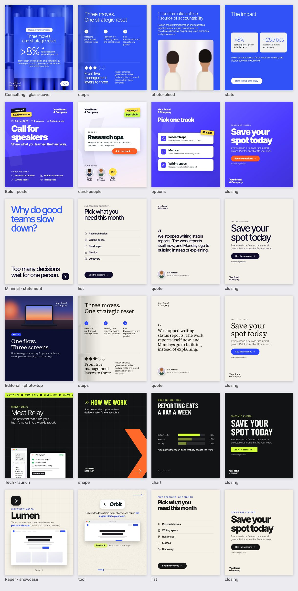
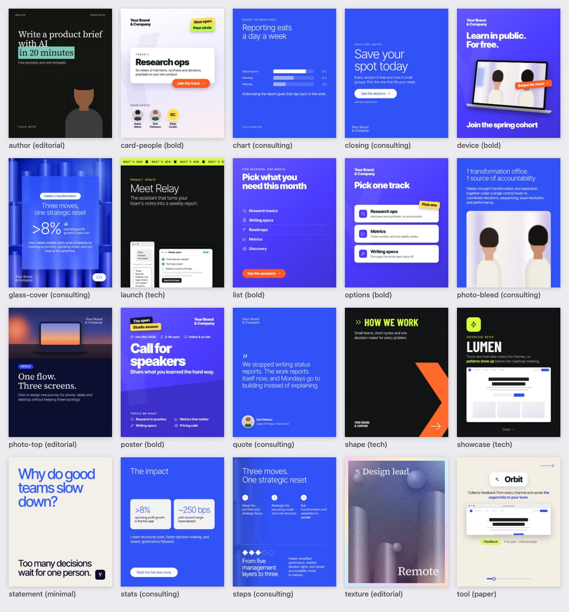

# carousel-agent

A Claude Agent SDK agent that turns a brief into a LinkedIn carousel, or a single graphic post, in one of six visual
styles: the consulting look (electric-blue canvas, light type, hero numbers, a frosted-glass cover over a 3D render),
a loud community poster, a typographic statement, an editorial magazine look, a dark product-launch look and a
warm-paper tool showcase. It builds every slide as HTML on a fixed design system from a library of layouts, uses OpenAI
image generation (`gpt-image-2.5`) only for the imagery underneath, checks its own layout, and exports PNGs plus a
swipeable PDF.



> Styles are emulated: layout, type scale, colour and effects, written from scratch with fictional sample content. Your
> own logo, colours and fonts come from the product folder (or a brand file); don't put another company's name or logo
> on your posts.

## How it works

```
brief ──► Claude (Agent SDK) ──┬─► set_style ───────► one of six styles for the whole post
                               ├─► generate_image ──► OpenAI gpt-image-2.5 ──► assets/*.jpg|png   (imagery only, never text)
                               ├─► write_slide ─────► HTML fragment + base + style CSS ──► Playwright ──► preview + layout QA
                               ├─► review_carousel ─► contact sheet of all slides
                               └─► export_carousel ─► png/*.png (2160px) + carousel.pdf + post.md (caption, alt text)
```

- **Styles change the look, layouts the structure.** A style (`src/design/styles/<id>.css`) sets the canvases, type,
  colours and component skins on top of a shared base (`src/design/base.css`); the 20 layouts
  (`src/design/layouts/*.html`) are starting points the agent adapts, and each works in every style. The agent picks
  the style that fits the brief (`--style auto`, preferring the product's house style) or you fix one.
- **Images are raw material.** OpenAI renders a background, photo, still life, illustration or transparent cut-out;
  all words, numbers, charts, interfaces and the palette are added in HTML/CSS. A house-style suffix (the style's or
  brand's palette, lighting, "no text") is appended to every prompt, and requests are cached so layout iterations cost
  nothing. Real people and real product screenshots only come from your files (`--asset`).
- **HTML effects do the styling.** `bg--duotone` forces any image into the palette; `glass` is a real
  `backdrop-filter` panel; stickers, a faint logo watermark, device mockups (laptop, phone, tablet), app windows with
  HTML UI mocks, a ticker band, geometric shapes, highlighter marks, grain, stipple, grid and paper textures do the rest.
- **Self-checking.** Every `write_slide` returns a rendered preview and diagnostics: text cut off or within 40px of an
  edge, text spilling out of a panel, overlapping text, content running into the bottom margin, fonts under 22px,
  missing images, >70 words. Decoration (the ticker, the watermark, UI mocks) is exempt. Hero numbers and headlines
  auto-shrink to fit.
- **Composition checks.** The QA also catches what makes a slide look assembled rather than designed: an empty
  horizontal band taller than the style allows (`maxBand` in `src/styles.ts`: about a quarter of the slide for bold,
  more for minimal), blocks glued together, content running into the next cue, a positioned logo or the progress bar,
  a floating sticker over a UI mock or a button, and a UI mock that leaves its screen half empty. `review_carousel`
  adds cross-slide notes: a logo that moves, left-aligned headlines on different left edges.
- **Locked down.** The agent gets only `Read` plus the six carousel tools (`permissionMode: "dontAsk"`, no Bash, no
  writes outside the run folder), user/project Claude settings are not loaded, and the renderer blocks all network
  access.

## Styles

| Style | Look | Best for |
|---|---|---|
| `consulting` | saturated brand canvas, light type, hero numbers, hairlines, frosted glass over a 3D render | case studies, results, data stories |
| `bold` | brand gradient, black-weight headlines, tilted stickers, a huge faint logo, white panels and option cards, bright CTA buttons, device mockups, avatars | events, calls for speakers or participants, programmes, community news |
| `minimal` | paper canvas, oversized grotesk in two colours, a small mark, nothing else | questions, opinions, principles, quotes |
| `editorial` | serif headlines, photo-led splits, uppercase tags, a highlighter mark, mono labels; paper, navy or near-black; grainy gradient posters | articles, how-tos, author posts, hiring |
| `tech` | near-black with a fine grid, neon mono kickers, a ticker band, condensed caps, UI windows bleeding off the edge, big shapes | product updates, launches, AI and dev topics |
| `paper` | warm paper with grid or speckle, app icons, browser-framed screenshots, letter-spaced kickers, bold black headlines, a progress bar | tool roundups, feature tours, how-to steps |

Each style's rules for the agent (canvases, type, signature components, imagery, what to avoid) are in
[`src/styles.ts`](src/styles.ts).

## Layouts



`glass-cover`, `steps`, `photo-bleed`, `stats`, `chart`, `quote`, `closing` (the consulting set); `poster`, `device`,
`options`, `card-people`, `list`, `statement` (posters, options, people, lists, statements); `photo-top`, `author`,
`texture` (editorial covers); `launch`, `shape`, `showcase`, `tool` (products and tools). Layouts place the slide's
main block with `my-auto`, so they fill both the square and the portrait canvas. Every file starts with a comment saying what it is
for and what it needs; the agent reads them all.

## Setup

```bash
npm install
npm run setup                 # downloads Playwright's Chromium (once)
cp .env.example .env          # add OPENAI_API_KEY (Claude auth: see below)
npm run demo                  # renders a style's sample carousel without calling Claude (mock art if no OpenAI key)
npm run smoke                 # exercises every agent tool and every style without calling Claude
npm run gallery               # every layout in every style, with layout QA → out/gallery/<format>/
```

### Claude auth

The Agent SDK runs Claude Code under the hood, so it can use your Claude subscription instead of an API key:

- **On your own machine:** install Claude Code and log in once (`claude`, then `/login`). Leave `ANTHROPIC_API_KEY`
  empty; the agent uses that login.
- **On a server / container:** run `claude setup-token` on your machine and put the token in `.env` as
  `CLAUDE_CODE_OAUTH_TOKEN`.
- **API billing instead:** set `ANTHROPIC_API_KEY` (it takes precedence over the subscription).

The CLI prints which credential it used at start-up. Subscription runs count against your plan's usage limits.

## Usage

```bash
npm run generate -- "Reckitt reset its portfolio, operating model and cost base at once: three moves, >8% operating profit growth in year one, ~250 bps margin path, five management layers to three, one transformation office."

npm run generate -- --file ../../workspace/briefs/q3-case.md --slides 5 --format portrait
npm run generate -- --file brief.md --style tech                         # fix the style (default: auto)
npm run generate -- --file brief.md --single --style bold                # one graphic post, 4:5
npm run generate -- --file brief.md --asset product.jpg --asset team.jpg # your own images
npm run generate -- --file brief.md --brand ../../workspace/brands/acme.json --budget 3
npm run generate -- --file brief.md --product acme                       # another product (workspace/products/acme)
npm run generate -- --file brief.md --product none                       # no product: each style's own palette

npm run demo -- portrait editorial                                       # a style's sample carousel, no Claude
npm run gallery -- portrait --style bold --product default               # every layout in your product's brand
```

| Option | |
|---|---|
| `-f, --file` | the brief (inline text is appended) |
| `-n, --slides <n>` | exact slide count (default: the agent picks 4 to 6; `1` = a single post) |
| `-s, --style <s>` | `auto` (default) or `consulting`, `bold`, `minimal`, `editorial`, `tech`, `paper` |
| `--single` | one standalone graphic (an image post) instead of a carousel |
| `--format <f>` | `square` (1080²) or `portrait` (1080×1350). Default: square for carousels, portrait for single posts |
| `-a, --asset ` | your photos, portraits (cut-out PNGs work best), screenshots, logos (repeatable) |
| `--product`, `--brand`, `-o, --out`, `-m, --model`, `--budget`, `-q` | see "Brand"; output root, model, spend cap, quiet |

Each run writes to `<timestamp>-<slug>/` in the workspace's `out/carousel/` (`--out` or `OUTPUT_DIR` to change it; see
[`lib/workspace.mjs`](../../lib/workspace.mjs)):

| path | what |
|---|---|
| `png/slide-NN.png` | final slides, 2160×2160 or 2160×2700 (`EXPORT_SCALE`) |
| `carousel.pdf` | upload as a LinkedIn document post for the swipeable carousel (not written for a single post) |
| `post.md` | caption and alt text per slide |
| `slides/slide-NN.html` | the editable fragments; tweak by hand, then `npm run render -- <run>` |
| `assets/` | generated images and your `--asset` files (+ `.cache.json`) |
| `preview/`, `build/` | 1× previews and the composed HTML used for rendering |
| `product-context.md`, `run.json`, `manifest.json` | the product context the agent got; the kind (carousel/single), style, format, brand and product the run used |

`npm run render -- <run>` re-renders in the run's recorded style (runs from before styles existed render as consulting).
Without `OPENAI_API_KEY` (or with `IMAGE_MOCK=1`) the agent still runs end to end with offline placeholder art.

## Single posts

`--single` (or `--slides 1`) makes one image that works alone in the feed: a cover-type layout (`poster`, `statement`,
`device`, `photo-top`, `author`, `texture`, `glass-cover`, `launch`, `card-people`, `closing`), the brand visible, no
swipe cues (the QA warns about `next`, `swipe`, `progress` or `counter`), ≤ 35 words, the detail in the caption. The
export is `png/slide-01.png` and `post.md`, no PDF.

## Brand

The brand comes from the first of:

1. `--brand <file>`: a brand file (format below);
2. **the product folder** (`--product <dir|id>`, else `$PRODUCT_DIR`, else the workspace's `product/`; see
   [`templates/product/README.md`](../../templates/product/README.md));
3. `$BRAND_FILE`, then `./brand.json` (the classic electric-blue consulting look; the other styles keep their own
   designed palettes).

From a product folder (`src/product.ts`):

- **Consulting** maps the design tokens as before: the canvas is the primary colour when white text reads on it,
  otherwise the product's dark inverse colour with the primary as the accent (CTA pill, next arrow, one highlighted
  number); the glass panel, glows and duotones follow.
- **The other styles** read a palette (`src/palette.ts`, injected as `--c-*` CSS variables): primary, accent (buttons),
  paper, ink, a dark colour for dark canvases (the inverse or text role when it is near-black), the primary darkened
  where it must read on paper, and up to three **highlight fills** for stickers, markers, tickers and tags: the bright,
  saturated colours in the tokens (a lime, a yellow), never the roles. The product's `shape` sets the button radius.
- **Fonts** by role: the product's display (or sans) face for headlines, its sans for body, its serif where a style
  uses a serif, its `font.family.condensed` for tech's condensed caps (otherwise the style keeps Barlow Condensed), its
  mono for labels (otherwise JetBrains Mono). Faces without files keep the style's bundled ones.
- **Logos:** the inverse logo on dark canvases, the primary one on light ones, the logo as the faint `watermark--logo`,
  and the `mark` logo for `logo-mark`.

`product.json → agents.carousel` can set every consulting colour (`brand.canvas`, `accent`, `glow`, `glassTint`, …),
`wordmark: "text"`, the `imageStyle`, a house style (`style: "bold"`, preferred when the agent picks), the `highlights`
(`["{color.lime}", "{color.yellow}"]`) and `fonts: "style"` (each style keeps its own type). The product context
(`BRIEF.md`, voice, messaging, facts) goes into the system prompt, so the copy follows the product's voice and uses only
its verified facts, whichever brand and style are applied.

`brand.json` holds the wordmark text or a logo file (and optionally `logoOnLight` and a square `mark`), the colour tokens
and the fonts. Fonts default to Inter Tight (sans) and Source Serif 4 (wordmark), bundled via Fontsource; point
`fonts.sans.files` (or `display`, `serif`, `mono`, `condensed`) at your own `.woff2` files per weight to use brand fonts.
`imageStyle` steers the palette description sent to the image model. An explicit brand file also colours the other
styles (primary, accent, surface as paper, ink, primaryDeep as the dark colour).

```json
{ "wordmark": { "text": "Acme\n& Partners", "logo": "assets/acme-logo-white.svg", "mark": "assets/acme-mark.svg" },
  "colors": { "primary": "#3052F7", "primaryDeep": "#1E33B8", "primaryLight": "#6F8BFF", "violet": "#7A5CFF",
              "surface": "#F2F2F2", "ink": "#101E21", "onPrimary": "#FFFFFF" } }
```

## Image models

`OPENAI_IMAGE_MODEL` defaults to `gpt-image-2.5-flare` (fast, good for social content). The agent can switch a single
image to `sunburst` (finer detail and precise edits, slower, same price) via the tool's `variant` argument. Image styles:
`3d-mono`, `photo`, `still-life`, `illustration`, `abstract`, `cutout` (transparent) and `raw`. Backgrounds default to
the `hd` size (~3.5 MP, e.g. 1920×1920) so they stay sharp at 2× export; older models fall back to 1024-based sizes.
`--asset` images can be passed as `reference_images` to restyle a real product shot through the edit endpoint.

## Files

```
src/agent.ts             query() setup: system prompt, in-process MCP server, tool allow-list, budget
src/prompt.ts            styles, narrative (carousel or single post), copy and image rules, components, layouts, workflow
src/tools.ts             set_style, generate_image, write_slide, remove_slide, review_carousel, export_carousel
src/styles.ts            the six styles: look, best for, the agent's rules, fonts, image palette, demo sequence
src/layouts.ts           loads the layout library
src/palette.ts           brand colour roles → the --c-* palette the styles read
src/design/base.css      the shared design system (canvases, components, effects); its defaults are the consulting look
src/design/styles/       one CSS file per style
src/design/layouts/      the layout templates (style-agnostic, fictional sample copy)
src/design/components.md component reference the agent reads
src/design/icons.ts      line icons, shapes, arrows and textures as CSS masks
src/render/              fragment → full HTML (fonts by role, brand tokens, style) and Playwright rendering + layout QA
src/images/              OpenAI generation with house style, caching, mock art
src/slides.ts            write / preview / contact sheet / export (PNG + PDF + post.md)
src/demo.ts, gallery.ts  sample carousels and the layout × style matrix without Claude (samples.ts: their images)
docs/                    styles.jpg and layouts.jpg (npm run gallery -- portrait --docs; the neutral brand only)
```

To add a component: add the CSS to `base.css` (colours through canvas variables, so every style can skin it), document
it in `components.md` (the agent only uses what is documented), and use it in a layout. To add a layout: a new
`src/design/layouts/<id>.html` with the header comment; list it in the styles it suits (`src/styles.ts`). To add a style:
a CSS file in `src/design/styles/` that defines every canvas, an entry in `src/styles.ts` and `STYLE_IDS` in
`src/config.ts`. Then run `npm run gallery` (both formats, and `--product default`) until it reports no layout errors.

## Running it as a service

`runCarouselAgent()` in `src/agent.ts` is UI-agnostic: call it from a queue worker or HTTP handler and stream
`onMessage` events. It needs Chromium, so host it where a headless browser can run (container with Playwright's
image, Modal, Trigger.dev, Cloudflare Sandbox). Set `MAX_BUDGET_USD`.
