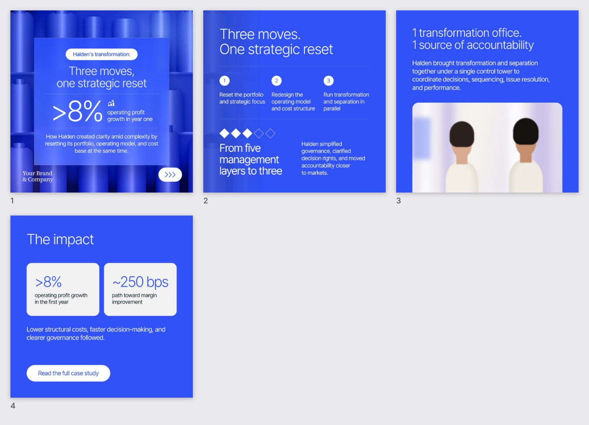

# carousel-agent

A Claude Agent SDK agent that turns a brief into a LinkedIn carousel in the visual language of top-tier consulting
firms' posts: electric-blue canvas, light-weight type, hero numbers, hairline rules, a frosted-glass cover over a
monochrome 3D render. It builds every slide as HTML on a fixed design system, uses OpenAI image generation
(`gpt-image-2.5`) only for the imagery underneath, checks its own layout, and exports PNGs plus a swipeable PDF.



> The style is emulated: layout, type scale, colour and effects. Your own wordmark/logo comes from the product folder
> (or a brand file); don't put another firm's name or logo on your posts.

## How it works

```
brief ──► Claude (Agent SDK) ──┬─► generate_image ──► OpenAI gpt-image-2.5 ──► assets/*.jpg|png   (imagery only, never text)
                               ├─► write_slide ─────► HTML fragment + design system ──► Playwright ──► preview + layout QA
                               ├─► review_carousel ─► contact sheet of all slides
                               └─► export_carousel ─► png/*.png (2160px) + carousel.pdf + post.md (caption, alt text)
```

- **Images are raw material.** OpenAI renders a background (3D render, photo, abstract forms or a transparent cut-out);
  all words, numbers, charts and the brand palette are added in HTML/CSS. A house-style suffix (palette, lighting,
  "no text") is appended to every prompt, and requests are cached so layout iterations cost nothing.
- **HTML effects do the styling.** `bg--duotone` forces any image into the brand blue; `glass` is a real
  `backdrop-filter` frosted panel; `fx-grain`, `fx-glow`, `fx-vignette`, `fx-dots`, `fx-grid`, `bg--ghost` (faint echo of
  the cover on inner slides) and `photo--bleed-bottom` produce the rest of the look.
- **Self-checking.** Every `write_slide` returns a rendered preview and diagnostics: text cut off or within 40px of an
  edge, text spilling out of a panel, overlapping text, fonts under 22px, missing images, >70 words. Hero numbers
  auto-shrink to fit and stay equal across a row of cards.
- **Locked down.** The agent gets only `Read` plus the five carousel tools (`permissionMode: "dontAsk"`, no Bash, no
  writes outside the run folder), user/project Claude settings are not loaded, and the renderer blocks all network
  access.

## Setup

```bash
npm install
npm run setup                 # downloads Playwright's Chromium (once)
cp .env.example .env          # add OPENAI_API_KEY (Claude auth: see below)
npm run demo                  # renders examples/demo without calling Claude (mock art if no OpenAI key)
npm run smoke                 # exercises every agent tool without calling Claude
```

### Claude auth

The Agent SDK runs Claude Code under the hood, so it can use your Claude subscription instead of an API key:

- **On your own machine:** install Claude Code and log in once (`claude`, then `/login`). Leave `ANTHROPIC_API_KEY`
  empty; the agent uses that login.
- **On a server / container:** run `claude setup-token` on your machine and put the token in `.env` as
  `CLAUDE_CODE_OAUTH_TOKEN`.
- **API billing instead:** set `ANTHROPIC_API_KEY` (it takes precedence over the subscription).

The CLI prints which credential it used at start-up. Subscription runs count against your plan's usage limits.

## Usage

```bash
npm run generate -- "Reckitt reset its portfolio, operating model and cost base at once: three moves, >8% operating profit growth in year one, ~250 bps margin path, five management layers to three, one transformation office."

npm run generate -- --file ../../workspace/briefs/q3-case.md --slides 5 --format portrait
npm run generate -- --file brief.md --asset product.jpg --asset team.jpg   # your own images
npm run generate -- --file brief.md --brand ../../workspace/brands/acme.json --budget 3
npm run generate -- --file brief.md --product acme                      # another product (workspace/products/acme)
npm run generate -- --file brief.md --product none                       # the classic electric-blue look
```

Each run writes to `<timestamp>-<slug>/` in the workspace's `out/carousel/` (`--out` or `OUTPUT_DIR` to change it; see
[`lib/workspace.mjs`](../../lib/workspace.mjs)):

| path | what |
|---|---|
| `png/slide-NN.png` | final slides, 2160×2160 or 2160×2700 (`EXPORT_SCALE`) |
| `carousel.pdf` | upload as a LinkedIn document post for the swipeable carousel |
| `post.md` | caption and alt text per slide |
| `slides/slide-NN.html` | the editable fragments; tweak by hand, then `npm run render -- <run>` |
| `assets/` | generated images (+ `.cache.json`) |
| `preview/`, `build/` | 1× previews and the composed HTML used for rendering |
| `product-context.md`, `run.json` | the product context the agent got, and which brand/product the run used |

Without `OPENAI_API_KEY` (or with `IMAGE_MOCK=1`) the agent still runs end to end with offline placeholder art.

## Brand

The brand comes from the first of:

1. `--brand <file>`: a brand file (format below);
2. **the product folder** (`--product <dir|id>`, else `$PRODUCT_DIR`, else the workspace's `product/`; see
   [`templates/product/README.md`](../../templates/product/README.md));
3. `$BRAND_FILE`, then `./brand.json` (the classic electric-blue look).

From a product folder (`src/product.ts`), the design tokens map onto the consulting look: the canvas is the primary
colour when white text reads on it, otherwise the product's dark inverse colour with the primary as the accent (CTA pill,
next arrow, one highlighted number); the glass panel, glows, duotones and the wordmark (the product's logo files, inverse
on dark slides) follow, and the product's own fonts load from its font files. `product.json → agents.carousel` can set
every colour (`brand.canvas`, `accent`, `glow`, `glassTint`, …), `wordmark: "text"` and the `imageStyle`. The product
context (`BRIEF.md`, voice, messaging, facts) goes into the system prompt, so the copy follows the product's voice and
uses only its verified facts, whichever brand is applied.

`brand.json` holds the wordmark text or a logo file, the colour tokens and the fonts. Fonts default to Inter Tight
(sans) and Source Serif 4 (wordmark), bundled via Fontsource; point `fonts.sans.files` at your own `.woff2` files per
weight to use brand fonts. `imageStyle` steers the palette description sent to the image model.

```json
{ "wordmark": { "text": "Acme\n& Partners", "logo": "assets/acme-logo-white.svg" },
  "colors": { "primary": "#3052F7", "primaryDeep": "#1E33B8", "primaryLight": "#6F8BFF", "violet": "#7A5CFF",
              "surface": "#F2F2F2", "ink": "#101E21", "onPrimary": "#FFFFFF" } }
```

## Image models

`OPENAI_IMAGE_MODEL` defaults to `gpt-image-2.5-flare` (fast, good for social content). The agent can switch a single
image to `sunburst` (finer detail and precise edits, slower, same price) via the tool's `variant` argument. Backgrounds
default to the `hd` size (~3.5 MP, e.g. 1920×1920) so they stay sharp at 2× export; older models fall back to 1024-based sizes.
`--asset` images can be passed as `reference_images` to restyle a real product shot through the edit endpoint.

## Files

```
src/agent.ts            query() setup: system prompt, in-process MCP server, tool allow-list, budget
src/prompt.ts           style guide, narrative + copy rules, image rules, workflow (+ components.md + examples)
src/tools.ts            generate_image, write_slide, remove_slide, review_carousel, export_carousel
src/design/system.css   the design system (components + effects)
src/design/components.md  component reference the agent reads
src/design/icons.ts     line icons as CSS masks
src/render/             fragment → full HTML (fonts, brand tokens) and Playwright rendering + layout QA
src/images/             OpenAI generation with house style, caching, mock art
src/slides.ts           write / preview / contact sheet / export (PNG + PDF + post.md)
examples/demo/          reference carousel used as few-shot examples in the system prompt
```

To add a component: add the CSS to `system.css`, document it in `components.md` (the agent only uses what is
documented), and optionally show it in an `examples/demo` slide.

## Running it as a service

`runCarouselAgent()` in `src/agent.ts` is UI-agnostic: call it from a queue worker or HTTP handler and stream
`onMessage` events. It needs Chromium, so host it where a headless browser can run (container with Playwright's
image, Modal, Trigger.dev, Cloudflare Sandbox). Set `MAX_BUDGET_USD`.
