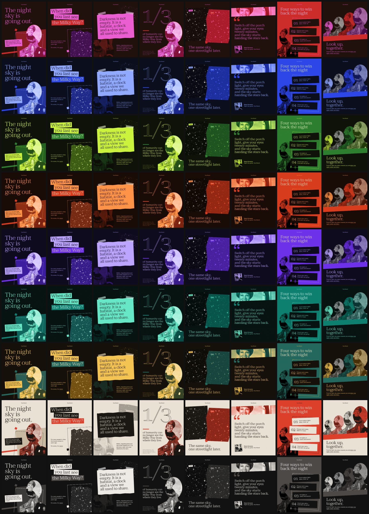

# Collage post agent

A Claude Agent SDK agent that turns a brief into collage-style social posts (single posts or carousels). Eight editorial layouts (breakout cover, paper-strip question, taped note, giant figure, split, quote, stacked sheets, echo) and nine palettes re-skin type, shapes and photos; with a product folder, a tenth palette, the fonts and the masthead come from the product's brand.



The agent writes each slide as **HTML** and uses **GPT Image 2.5** only for the image ingredients: cutouts, portraits, textures, objects. Type, colour, duotones, outlines, tilts, torn edges and grain are all HTML/CSS. For real, named people it uses public-domain photos from Wikimedia Commons instead of generating faces. Every run ends with:

```
workspace/out/collage-post/<job-id>/      (OUTPUT_DIR to change it; see lib/workspace.mjs)
  slide-01.html … slide-07.html   editable slides (open in any browser)
  png/slide-01.png …              1080×1350 exports (or 2160×2700 with --scale 2)
  assets/                         the generated / downloaded images
  _design/                        CSS, runtime and fonts, so the folder works offline
  caption.md                      caption, alt text, sources
  CREDITS.md                      Wikimedia credits (when used)
  plan.md                         the agent's slide plan
  index.html                      gallery page
  <job-id>.zip                    everything above, ready to share
```

## Setup

Requires Node 20.12+.

```bash
npm install                 # also downloads Chromium for the PNG export
cp .env.example .env        # add ANTHROPIC_API_KEY and OPENAI_API_KEY
npm test                    # optional: zero-cost smoke test (mock Claude + OpenAI APIs, real SDK, Chromium, export)
```

## Use

**Web UI**

```bash
npm run web                 # http://localhost:4747
```

Type a brief, pick slide count and palette (or Auto), and watch the agent work: its notes, the images it sources, and the slides as they render. When it finishes, download PNGs, HTML or the zip, or type a change ("slide 3: shorter headline, use ultraviolet") and press **Revise**. Revisions resume the same agent session, so it remembers the post.

**CLI**

```bash
npm run post -- "Why we still need explorers. Angle: curiosity is a habit that feeds quietly wear down. Mention Ada Lovelace and Marie Curie; end with today's explorers."
npm run post -- --file brief.md --slides 5 --palette saffron --brand "Your Brand"
npm run post -- --revise 20261006-101500-why-we-still "Echo slide: four different people instead of one"
npm run post -- --file brief.md --product ~/clients/acme/product    # another product's palette, fonts, masthead, voice
npm run post -- --file brief.md --product none                      # no product folder: the nine palettes, $BRAND_NAME
npm run post -- --help
```

A brief can be a topic and an angle (the agent writes the copy) or finished copy (used verbatim and only split across slides). The agent writes in the brief's language, Romanian diacritics included.

## How it works

```
brief ─► Claude (Agent SDK, custom system prompt)
          ├─ Read      STYLEGUIDE.md + the layout templates it will use
          ├─ Write     plan.md
          ├─ find_public_domain_image   Wikimedia Commons (Wikidata portrait first) for named people/artworks
          ├─ generate_image             GPT Image 2.5: greyscale ingredients, transparent cutouts
          ├─ Write     slide-NN.html    from design/layouts/*, palette via <html data-palette>
          ├─ render_slides              Chromium → PNGs + layout checks + contact sheet the agent looks at
          │    └─ fix and re-render (max 3 rounds)
          └─ Write     caption.md
host ─► final PNG export at the chosen scale, CREDITS.md, index.html, zip
```

- **Design system**: `design/collage.css` (tokens, effects, paper pieces, the 8 layouts), `design/collage.js` (builds duotone/tritone and outline SVG filters from the palette, shrinks headlines to fit, checks for overflow, overlap and broken images), `design/palettes.css` (generated from `src/palettes.ts`).
- **Image rules**: no text or logos in generated images; generated people are anonymous archetypes; named real people come only from Wikimedia (public domain/CC0 by default, CC BY/BY-SA with `--cc-by`, credits recorded automatically).
- **Guardrails**: the agent can only write inside its job folder (not `_design/`), can only read the job folder, `design/`, your reference posts (optional, see below) and the style guide (paths are compared with symlinks resolved, as Claude Code reports them, so an `OUTPUT_DIR` behind a symlink works and a link out of the job folder or into `_design/` doesn't), has no shell or web access, ignores MCP servers configured on your machine, and stops at `MAX_BUDGET_USD`. Image generation stops at `MAX_IMAGES` per post.

## Palettes and layouts

See `STYLEGUIDE.md` for the spec (type scale, colour roles, collage vocabulary, layout geometry). To see every layout in every palette with the sample images (the picture at the top of this README):

```bash
npm run preview             # → workspace/out/collage-post/_preview/<palette>/contact.jpg
npm run preview -- brand    # the product folder's palette, fonts and masthead
```

| Palette | Mood |
|---|---|
| `orchid` | the templates' own look (only when asked) |
| `cobalt` | science, data, tech |
| `acid` | urgent, manifestos |
| `ember` | warm, activist |
| `ultraviolet` | philosophy, art |
| `verdigris` | nature, health, care |
| `saffron` | history, books, heritage |
| `newsprint` | light paper, journalistic |
| `graphite` | monochrome, serious |

Layouts: 01 breakout (the cover) · 02 strips (a question) · 03 note (the core claim) · 04 figure (a number or date) · 05 split (then / now) · 06 quote · 07 sheets (3–4 steps; the loud slide) · 08 echo (community, the closing call to action).

## The product folder

With a product folder (`--product <dir|id>`, else `$PRODUCT_DIR`, else the workspace's `product/`; see
[`templates/product/README.md`](../../templates/product/README.md)) every post is made for that product:

- **Palette `brand`**, built from the product's colour roles (or set in `product.json → agents.collage-post.brandPalette`)
  and registered next to the nine palettes. It is the default palette; `--palette <name>` still picks another one.
- **Fonts**: the product's serif and sans replace Roboto Serif and Inter, loaded from the product's font files
  (`agents.collage-post.fonts: "brand"`).
- **Masthead**: the product's wordmark.
- **Context**: `PRODUCT.md` in the job folder (brief, voice, messaging, facts), read before planning and protected from
  edits. The copy follows the product's voice and uses only its verified facts.

Order of precedence: command-line flags, then the product folder, then `.env` (`PALETTE`, `BRAND_NAME`), then the
built-in defaults. Tests ignore the repo's product folder; `test/product.test.ts` checks the mapping on a fictional
fixture.

## Customising

- **Brand**: the product folder (above), or `BRAND_NAME` in `.env` / `--brand` for the masthead alone.
- **New palette**: add an entry to `BASES` in `src/palettes.ts` (eight colours; duotones are derived), then `npm run build:design`.
- **Layouts**: edit `design/layouts/*.html` and the matching `L-*` block in `design/collage.css`; the agent copies the template structure, so changes apply to the next post.
- **Reference posts**: put screenshots of posts whose look you want to match in the workspace's `references/collage-post/` (`REFERENCE_DIR` to change it; they stay out of the kit, since they're usually someone else's work). The agent may read them; it copies the look, never the copy or the images.
- **Models**: `AGENT_MODEL=sonnet` is cheaper; `OPENAI_IMAGE_MODEL=gpt-image-2.5-sunburst` gives the highest image quality.

## Costs

Each post makes 1 Claude agent run plus up to `MAX_IMAGES` GPT Image calls. The CLI and the UI show the Claude spend per run, and `MAX_BUDGET_USD` caps it. Revisions are cheaper because the session resumes and only changed images are regenerated.
