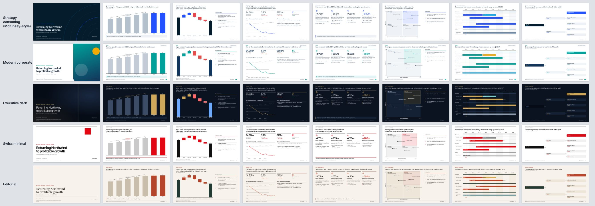
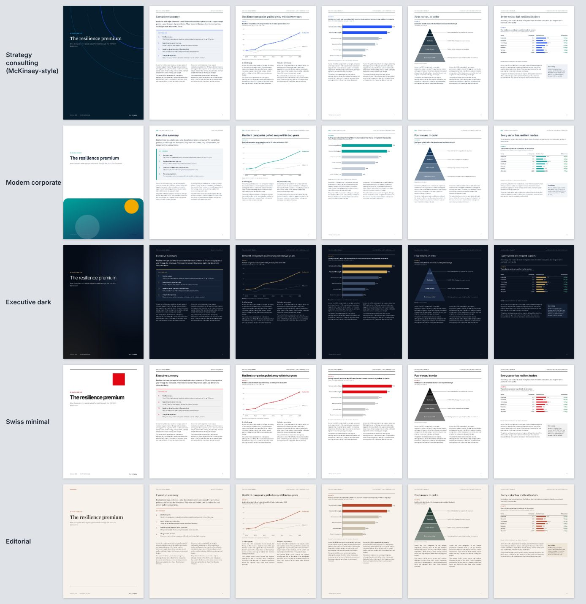

# deck-agent

A Claude Agent SDK agent that turns a brief (plus your data files) into a finished corporate PDF: a **16:9 presentation deck** or an **A4 portrait report**. It picks whichever one the brief needs. When you ask for a McKinsey-style document it follows the consulting method end to end: answer first, a storyline, action titles, sourced exhibits and a single accent colour.

Each element (chart, diagram, table, KPI tiles) is generated as HTML/SVG from a data spec and checked as a PNG. Pages are composed from a layout library, rendered to PNG by Chromium and QA-checked automatically. The PDF is assembled from those page PNGs, with a hidden text layer so you can still search and copy the text.




Sample output (built without Claude by `npm run demo`): [`examples/demo-mckinsey-style-deck.pdf`](examples/demo-mckinsey-style-deck.pdf) · [`examples/demo-a4-report.pdf`](examples/demo-a4-report.pdf). All companies and numbers in the samples are fictional.

## Quick start

```bash
npm install
npm run setup            # downloads Playwright's Chromium (or set CHROMIUM_PATH; installed Google Chrome is used as a fallback)
cp .env.example .env     # optional: API key, budget, image settings
npm run demo             # sanity check: renders the sample deck + report, no Claude needed

npm run deck -- --file briefs/example-board-deck.md -i data/northwind-segments.csv
npm run web              # local UI at http://localhost:4848
```

**Claude auth** (as in carousel-agent):

- **Your Claude subscription.** Nothing to set on a machine where Claude Code is logged in. On servers, use `CLAUDE_CODE_OAUTH_TOKEN` from `claude setup-token`.
- **Pay-as-you-go.** Set `ANTHROPIC_API_KEY`.

`MAX_BUDGET_USD` (default 8) caps the spend per run.

## CLI

```
npm run deck -- [brief text] [options]
  -f, --file <path>       brief from a file
      --format <f>        auto (default) | deck | report
  -t, --theme <t>         auto (default) | strategy | corporate | executive | swiss | editorial
  -n, --pages <n>         target page count
  -i, --input <path>      data (csv/xlsx/json), documents (md/txt/pdf) or images; repeatable
      --product <dir|id>  product folder for brand, voice and facts, the id of one in workspace/products, or "none"
                          (default: $PRODUCT_DIR, then the workspace's product/)
      --brand <path>      brand file; overrides the product folder's brand
      --audience, --lang, --model, --budget
      --revise <job-id>   apply a change request to an existing job (resumes the same agent session)
```

Examples:

```bash
npm run deck -- "McKinsey-style board deck: should Northwind enter Poland?" -i data/market.xlsx --pages 14
npm run deck -- --file briefs/example-report.md --format report --theme editorial -i data/sector-resilience.csv
npm run deck -- --revise 20261006-142233-mckinsey-style-board-deck "Turn page 6 into a waterfall and add an appendix"
npm run rerender -- 20261006-142233-mckinsey-style-board-deck --theme corporate --dpi 300   # no Claude, no cost
npm run deck -- --file brief.md --product acme                    # another product (workspace/products/acme)
```

## Web UI

Run `npm run web` and open http://localhost:4848. The UI lets you:

- write a brief and drop in files;
- pick the format, style, page count and budget;
- watch each page appear as the agent renders it;
- open or download the PDF;
- type a revision request to update the same document.

It binds to 127.0.0.1, accepts same-origin JSON POSTs only, and serves job files with a CSP.

## Formats

| | Canvas | PDF page | Typical use |
|---|---|---|---|
| `deck` | 1280×720 CSS px | 13.33 × 7.5 in (PowerPoint 16:9) | board/steering committee, strategy reviews, pitches, QBRs |
| `report` | 794×1123 CSS px | A4 portrait | research reports, white papers, market studies, annual/ESG reports |

With `--format auto` (the default) the agent decides from the brief. Page PNGs are exported at `EXPORT_DPI` (default 200; use 300 for a print shop).

## Themes (layout styles)

| Theme | Look | Best for |
|---|---|---|
| `strategy` | McKinsey-style: white, deep navy, one electric-blue accent, serif action titles, hairlines | board decks, strategy work, consulting-style reports |
| `corporate` | bold sans, rounded cards, teal/blue + amber, icons | company presentations, QBRs, sales/product decks |
| `executive` | dark navy, light type, muted gold, big thin numbers | investor/board keynotes, vision narratives |
| `swiss` | black/white, signal red, strict grid, heavy rules | design-led firms, research summaries |
| `editorial` | warm paper, Playfair headlines, serif report body | white papers, thought leadership, annual reviews |

The agent never puts McKinsey's (or any other firm's) name or logo on your pages. The brand on them is yours, and it comes from the first of:

1. `--brand <file>`: a brand file (name, wordmark text or logo, confidentiality line, colour and font overrides; `brands/example-brand.json` shows the format).
2. **The product folder** (`--product <dir|id>`, else `$PRODUCT_DIR`, else the workspace's `product/`; see [`templates/product/README.md`](../../templates/product/README.md)). Its design tokens map onto every theme, so each theme keeps its layout character in the product's colours, fonts and logo.
3. `$BRAND_FILE`, then `./brand.json`.

The product folder also feeds the prompt: the compiled context (`BRIEF.md`, voice, messaging, facts, offers, sales pitch; profiles `content` and `sales`) goes into the system prompt and into `product-context.md` in the job folder. The agent writes in the product's voice, may use its verified facts (never the ones marked draft), and prefers the product's house theme (`product.json → agents.deck.theme`) unless the brief asks for another style or `--theme` fixes one.

How the tokens become theme colours (`src/product.ts`):

| Product role | Deck |
|---|---|
| `accent`, `on-accent` | fills: highlighted cards, KPI tiles, tags, badges, the highlighted bar in charts, with on-accent text |
| `accent-text` | the accent as text, icons, bullets and thin lines on the page. A light accent (one that can't be read on the background, like a lime) is never used as text |
| `inverse`, `on-inverse` | section dividers, dark cards; the page and ink colour of dark themes (`executive`) |
| `text`, `text-muted`, `text-subtle`, `border`, `background`, `surface` | ink, secondary text, captions, hairlines, page, cards (with a hairline when cards barely differ from the page) |
| `font.family.*` + `typography.heading/body/*-accent` | heading, body and accent faces, loaded from the product's font files; a face without files keeps the theme's font |

With a light accent, `==highlighted==` words get a marker behind them instead of coloured text. `product.json → agents.deck` can override any of it: `colors`, `darkColors`, `fonts` (`heading`, `body`, `numbers`, `accent`: a role or a family), `highlightStyle`, `confidentiality`, `imageStyle`, `wordmark: "text"`, and `vars` (CSS variables such as `--title-weight`, `--accent-style: normal`, `--accent-weight: 300`). Without a product folder and brand overrides, every theme renders exactly as designed.

## What "McKinsey-style" means here

The system prompt (`src/prompt.ts`) and the QA encode the method:

- **Answer first.** A governing thought, then an executive summary (or SCR page) up front that states the answer and the supporting arguments.
- **Ghost deck before pages.** `plan_storyline` lints the titles: topic labels, length, duplicates. It also returns a title-only read-through so the story can be checked on its own.
- **Action titles.** Each title is a full sentence carrying the takeaway and the number that proves it, at most 2 lines. One message per page, and the body proves the title.
- **Honest exhibits.**
  - units in the subtitle, a source line on every data page (QA warns when one is missing) and numbered footnotes;
  - direct data labels and no chartjunk;
  - grey for context, with one accent for the point the title makes (`highlight` / `highlight_series`);
  - sorted bars and CAGR arrows;
  - in reports, exhibits are numbered automatically.
- **Facts only from the brief and files.** Anything missing becomes a visible `[X]` placeholder that is listed at the end.
- **Recommendations you can act on.** They end with next steps or the decisions requested.

## Agent tools (in-process MCP server `deck`)

| Tool | Purpose |
|---|---|
| `setup_document` | format, theme, metadata; returns the layout catalogue |
| `plan_storyline` | ghost deck + title lint + read-through |
| `inspect_data` | CSV / TSV / JSON / XLSX → column stats + rows |
| `create_chart` | column, bar, stacked/grouped column & bar, line, area, waterfall, donut, scatter/bubble, mekko |
| `create_diagram` | process (chevron/boxes/numbered), timeline, roadmap (Gantt), 2×2 matrix, pyramid, funnel, issue/driver tree, cycle |
| `create_table` | consulting tables with Harvey balls, RAG dots, checks, inline bars, deltas, totals |
| `create_kpis` | KPI tiles (value, label, delta, note, sparkline) |
| `write_page` | layout + slots → rendered page preview + diagnostics (insert/overwrite) |
| `view_page`, `move_page`, `remove_page` | page operations (renumber automatically) |
| `review_document` | re-render all, contact sheet, read-through, open issues |
| `export_document` | page PNGs, exhibit PNGs, PDF (text layer + bookmarks), storyline.md, manifest.json |
| `generate_image` | optional (needs `OPENAI_API_KEY`, or `IMAGE_MOCK=1`): photos/abstract/illustration as raw material only |

The only built-in tool is `Read`, and a hook keeps it inside the job folder. The hook and `inspect_data` compare paths with symlinks resolved, as Claude Code reports them, so an `OUTPUT_DIR` behind a symlink works and a link out of the job folder doesn't. Bash, Write, Edit and Web are disabled. The run also uses `settingSources: []`, `strictMcpConfig` and `permissionMode: "dontAsk"`.

## Layouts

**Deck:** `cover`, `agenda`, `section`, `executive-summary`, `scr`, `exhibit`, `chart-takeaways`, `two-column`, `columns`, `grid`, `kpi-dashboard`, `statement`, `image-text`, `closing`, `custom`.

**Report:** `cover`, `contents` (auto TOC with page numbers), `summary`, `chapter`, `article` (1–2 columns, exhibit top/bottom, sidebar, pull quote), `exhibit-page`, `numbers`, `two-column`, `columns`, `grid`, `scr`, `statement`, `back-cover`, `custom`.

Chrome is added automatically:

- **Deck:** tracker (current section), page numbers, sources/footnotes and the wordmark.
- **Report:** running header (title + chapter) and exhibit numbers.

Slots accept light markdown (`**bold**`, bullets, `### subheads`, `==accent==`, `^1^`) or sanitised HTML using the component classes, with `<x-el id="…">` placing an element anywhere.

## How rendering works

```
brief + files ──▶ Claude (Agent SDK) ──tools──▶ job folder
                                      │   doc.json, elements/*.json, pages/page-NN.json
                                      ▼
            compose (theme CSS + layout + slots + element specs)  ──▶ build/page-NN.html
                                      ▼
            Chromium: fonts → element runtime (charts/diagrams sized to their slot with real font metrics)
                      → layout QA → screenshot  ──▶ preview/*.jpg (to Claude) · png/*.png · exhibits/*.png
                                      ▼
            pdf-lib: page PNGs + invisible text layer + bookmarks  ──▶ presentation.pdf / report.pdf
```

- Elements are stored as specs, not pixels. The in-browser runtime (`src/elements/runtime/`, bundled with esbuild) fits each one to whatever slot it lands in, so changing the layout or theme never needs regenerating.
- **Layout QA runs on every page:**
  - text cut off or clipped, overlapping text (including inside charts), and containers or columns that overflow;
  - fonts below the minimum, titles over 2 lines, too many words;
  - pages that look empty, missing sources, missing elements and images that fail to load.
- Pages are self-contained. Network access is blocked at render time and fonts are bundled (@fontsource, OFL).

## Output (per job, `workspace/out/deck/<job-id>/`; `OUTPUT_DIR` to change it)

`presentation.pdf` or `report.pdf` · `png/page-NN.png` · `exhibits/page-NN-<element>.png` · `storyline.md` (title read-through + speaker notes) · `storyline-plan.md` · `manifest.json` · `preview/` · `pages/` + `elements/` (editable specs) · `product-context.md` (when a product folder was used) · `events.jsonl` · `job.json` (incl. the product and brand source)

## Development

```bash
npm run typecheck
npm test          # tool handlers, the Read guard (on a job folder behind a symlink), product folder mapping (fixture
                  # product), offline end-to-end with a mock Claude API (real SDK + CLI + MCP + hooks), web server.
                  # Tests ignore the workspace's product/ (PRODUCT_DIR=none).
npm run demo      # sample deck + report → workspace/out/deck/demo-*/, in the product's brand when there is one
                  # (--product none for the theme's own look)
npm run gallery   # every theme → docs/themes-*.jpg (themes' own look; --product <dir> → docs/themes-*-product.jpg)
```

## Limitations

- Pages are images with an invisible text layer, so the PDF is searchable and copyable but not editable in PowerPoint. The specs in `pages/` and `elements/` are the editable source; change them and run `npm run rerender`.
- Report body text does not flow across pages automatically. QA reports how many lines overflow, and the agent continues the text on the next `article` page.
- `.docx` inputs can't be read directly. Supply PDF, markdown or text instead.
